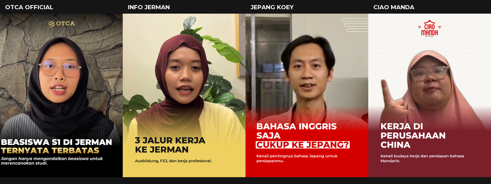

# Thumbnail empat brand — template v1.1

Ketetapan pengguna, 7 November 2026: setiap video baru dari empat brand ini
disertai thumbnail. Template dibakukan untuk penggunaan internal. Contoh asli pengguna tersimpan di
`referensi/`; daftar dan SHA-256 ada di `referensi.json`.



## Yang dikunci

- **OTCA Official (`otca`):** foto talent, fade hitam bawah, judul putih tebal,
  aksen gradien emas pada baris terakhir, logo emas resmi di tengah atas.
  Gradien isi huruf: `#FDF1A4` → `#E1C267` → `#B3822C`; teks pendukung putih miring.
  Montserrat Black 72 px, jarak baris 74 px, margin 8 px agar lebar tulisan
  mendekati contoh asli. Pendukung Montserrat Bold Italic 36 px, jarak 40 px.
  Font khusus OTCA dibundel di `aset/`; tidak mengikuti perubahan font brand lain.
- **Info Jerman (`info-jerman`):** foto talent, fade kuning **`#EDD05F`** hingga
  bidang bawah, judul dan pendukung hitam. Tanpa logo tambahan sesuai contoh.
  Nilai tersebut diambil dari bidang kuning bawah pada ketiga screenshot pengguna
  (04, 05, 06), bukan dari warna kuning PDF konsep.
- **Jepang Koey (`jepang-koey`):** foto talent, fade merah `#D40000`, judul
  putih, baris terakhir merah di atas bidang putih. Motif garis putih di kanan
  atas; tanpa logo tambahan sesuai contoh.
- **Ciao Manda (`ciao-manda`):** talent dipisahkan dari latar, bidang ivory
  dengan kontur tipis di atas,
  fade merah tua `#79202A`, judul putih, logo merah resmi di tengah atas.
  Latar lokasi/ilustrasi boleh mengikuti topik; pabrik bukan elemen wajib semua cover.

Untuk brand selain OTCA: Montserrat ExtraBold 76 px untuk judul dan SemiBold
34 px untuk pendukung, pada lebar 1080.
**Semua brand: headline maksimal 3 baris, subheadline maksimal 2 baris.**
Aturan berlaku pada kedua ukuran, termasuk baris hasil pembungkusan otomatis.
Jika melebihi batas, ringkas teks dahulu; jangan kecilkan font atau potong kalimat.
Font keluarga ini adalah standardisasi produksi berdasarkan tampilan contoh,
bukan klaim bahwa seluruh screenshot memakai berkas font yang sama.
Logo memakai aset resmi; tidak digambar ulang dengan teks.

PDF konsep Info Jerman, Jepang Koey, dan Ciao Manda memiliki beberapa pilihan
warna/font berbeda. Untuk **thumbnail**, screenshot terbaru pengguna menjadi
acuan susunan, peran warna dan tipografi. Pengecualian ini tidak mengubah token
video atau mengganti panduan brand secara menyeluruh. Jangan menyatukan empat
brand menjadi satu gaya. Perubahan desain bersama harus tercatat dengan versi baru.

Ikon Reels kanan atas pada screenshot merupakan antarmuka platform, **bukan
bagian artwork**. Jangan tambahkan ikon tersebut, watermark, CTA, alamat situs,
atau klaim pemasaran yang tidak tersedia/disetujui.

## Alur yang dipakai agen

1. Tentukan brand dan tulis judul singkat berdasarkan isi/transkrip video.
   Teks pendukung opsional; jangan mengarang manfaat, hasil atau jaminan.
2. Buat cover sebelum persetujuan storyboard dengan perintah `thumbnail` di
   bawah. Pilih foto tajam dan ekspresi yang tepat; baca timestamp terpilih di
   `out/thumbnail-qa.json`. Jika perlu, tetapkan `frame_time` pada manifest.
3. Sertakan **kedua gambar** bersama storyboard, lengkap dengan brand, judul,
   pendukung dan foto. Revisi di sini; setelah pengguna setuju, pertahankan
   konfigurasi dan sumber yang sama saat ekspor. Jangan menyetujui sendiri.
4. Setelah video diekspor lewat pintu pipeline, cover dibuat otomatis. Serahkan
   MP4 bersama cover dan pastikan hasil final sama dengan desain yang disetujui.
   Revisi cover saja memakai perintah `thumbnail`, tidak merender ulang video.

Contoh instruksi pemula:

> Edit video ini untuk OTCA Official. Sertakan thumbnail sesuai template OTCA
> yang tersimpan di proyek. Buat judul dari isi video, lalu tunjukkan storyboard
> dan dua ukuran cover untuk saya periksa sebelum render final.

## Pengaturan produksi

Tambahkan pada `proyek/<nama>/manifest.json` (jangan mengganti isi manifest lain):

```json
"thumbnail": {
  "brand": "otca",
  "headline": "BEASISWA S1 DI JERMAN\nTERNYATA TERBATAS",
  "subheadline": "Jangan hanya mengandalkan beasiswa untuk merencanakan studi.",
  "frame_time": 13.9
}
```

`frame_time` adalah detik pada footage sumber; angka di atas hanya contoh.
Alternatifnya: `"photo": "aset/grafis/foto-cover.jpg"` untuk foto pilihan.
`photo` dan `logo` khusus proyek menerima path relatif terhadap folder proyek,
atau path absolut. `logo: null` menghilangkan logo jika memang disetujui.
Untuk Ciao Manda, model segmentasi yang sama dengan pipeline dipakai pada satu
foto, lalu talent ditaruh pada bidang ivory. Periksa tepi hijab/rambutnya.
`"keep_background": true` mempertahankan lokasi asli bila pilihan itu disetujui.

Brand harus salah satu empat ID di atas. Proyek lama yang nama foldernya jelas
memuat ID brand dikenali otomatis; untuk proyek baru tetap tulis `thumbnail.brand`.
Brand lain tidak dipaksa memakai empat template ini. `"aktif": false` hanya untuk
pengecualian yang diminta pengguna. Judul default mengambil judul manifest;
agen tetap wajib menulis headline yang layak sebelum produksi.

```powershell
.venv/Scripts/python.exe pipeline/scripts/video.py thumbnail proyek/<nama>
```

Otomatis berjalan sesudah ekspor standar (`ekspor.py`) dan render final melalui
`video.py` untuk split, editorial, serta scholarship. Pemanggilan renderer
internal secara langsung melewati integrasi ini; gunakan pintu `video.py`.

## Hasil dan pemeriksaan

- `out/thumbnail.png` dan `.jpg`: **1080 × 1920**, cover vertikal.
- `out/thumbnail-grid.png` dan `.jpg`: **1080 × 1440**, cover 3:4 sesuai contoh.
- `out/thumbnail-qa.json`: asal foto/timestamp, ukuran font, kotak wajah/teks,
  versi dan sidik jari konfigurasi template. `thumbnail_hasil` dicatat di manifest.

Kedua ukuran ditata sendiri-sendiri agar tetap terbaca; file grid bukan crop
otomatis dari file vertikal. Jika aplikasi melakukan crop cover, atur posisinya
di aplikasi dan periksa sebelum unggah; satu crop tidak dijanjikan cocok untuk
semua tampilan platform.

Pemilih otomatis membandingkan ketajaman wajah pada lima waktu footage mentah.
Ia **tidak** menjamin mata terbuka, ekspresi terbaik, ketepatan isi judul, atau
potongan hijab/rambut sempurna. Periksa itu secara visual di storyboard.
QA otomatis menolak teks terlalu panjang/keluar kanvas dan wajah bertabrakan
dengan judul/terpotong kanvas. Ringkas teks atau pilih foto lain; tidak ada
pemotongan kalimat atau pengecilan font diam-diam. Jika satu format gagal,
gambar lama tidak ditimpa dan laporan ditandai GAGAL.

## Bukti uji v1.1

Empat pratinjau memakai footage asli proyek Nina beasiswa, Info Jerman 3 jalur,
Jepang Koey bahasa Inggris, dan Ciao Manda. Foto/teks contoh merupakan draf
demonstrasi, bukan persetujuan publikasi pengguna. Gambar demo ada di `pratinjau/`.
Video dan manifest lama tidak diubah oleh pembuatan demo.
Teks Ciao Manda pada demo diringkas agar memenuhi batas tiga baris.
Kalibrasi tipografi OTCA dengan teks dari screenshot 03 tersimpan sebagai
`pratinjau/otca-kalibrasi-tipografi.png`; foto talent kalibrasi tetap dari footage
demo, sehingga gambar ini bukan contoh isi untuk video beasiswa.
Konfigurasi warna/logo ada di `brand-v1.json`; renderer di
`pipeline/scripts/thumbnail.py`. Identitas brand dapat dipakai ulang; judul,
ekspresi dan latar mengikuti video masing-masing.
Konfigurasi v1.0 diarsipkan di `arsip/thumbnail/brand-v1.0.json`.
